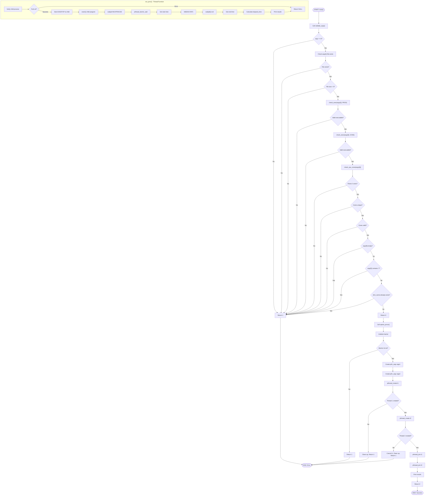

# args
runner "path to data file" "path to producer" "path to consumer" "cpu cores(2) sep with ','" "shm name"

The runner itself is not pinned to any core; the two cores given are the producer's and
consumer's own core, respectively. Each of producer/consumer pins its main thread to the
core it's given, and may pin a second/helper thread to `core + 1` (via `cpu_utils.h`'s
`pin_current_thread`/`get_current_cpu_core`), so pick core ids that leave each pair's
`core`/`core + 1` mapped to independent physical cores (check `lstopo` for SMT sibling pairs).

## prod/cons args
producer/consumer "shm name" "path to data file" "cpu core id"

## flowchart:

